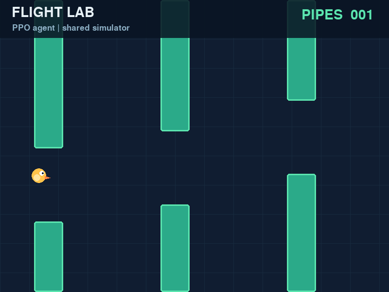

# Flappy Bird with PPO

A playable Flappy Bird game and a PyTorch implementation of **Proximal Policy Optimization**, with trained weights, seeded experiments, and a detailed mathematical report. Manual play, AI play, and training use exactly the same physics and collision code.



## Start playing

Python 3.10+ is required. From this directory:

```bash
python3 -m venv .venv
source .venv/bin/activate
python -m pip install -r requirements.txt
python main.py                 # Manual flight
python main.py --ai            # Watch the included trained PPO policy
```

| Control | Action |
|---|---|
| Space / Up / left click | Start, flap, or retry after a crash |
| P | Pause / resume |
| R | Restart with the next seeded course |
| Esc | Exit |

The reference model is `models/ppo.pt`; the other two trained policies are `models/ppo_seed2.pt` and `models/ppo_seed3.pt`. AI mode uses the largest policy logit by default. `--stochastic` samples actions instead; this is substantially less reliable for this checkpoint. `--seed 42` controls the course, and `--fps 120` speeds up playback without changing simulated physics.

## Train

```bash
python train_net.py --total-timesteps 1000000 --seed 1 --output runs/my_ppo
python main.py --ai --model runs/my_ppo/best.pt
python evaluate.py --model runs/my_ppo/best.pt --episodes 30 --output results/my_evaluation.json
```

Training is headless and uses CPU by default. Sixteen environments collect 256 frames each before every update. The one-million-frame request completes whole batches, so it actually collects 1,003,520 frames. See `python train_net.py --help` for configurable run sizes, learning rate, device, and validation settings.

Each run writes:

- `best.pt`: policy selected by mean score, then return, on validation courses 5000–5009.
- `latest.pt` and `final.pt`: most recent and final weights plus optimizer state.
- `metrics.csv`: losses, entropy, KL, gradient norms, training scores, and validation results.
- `config.json` and `validation.json`: configuration and final validation records.

Existing run directories containing a configuration are protected from accidental overwrite. To continue learning into a new run:

```bash
python train_net.py --resume runs/my_ppo/final.pt --output runs/continued
```

Use matching environment and PPO settings. Continuation restores weights and Adam state, starts fresh seeded environments, and restarts the learning-rate schedule. It does not restore mid-episode trajectories or RNG state.

## Measured results

Three training seeds were run for 1,003,520 frames each. Checkpoints were selected on validation courses and tested on thirty separate courses (seeds 10000–10029).

The bundled **seed-1 greedy policy** averaged **67.73 pipes**, reaching the 6,000-frame cap on **29/30 courses**. The maximum possible score at that cap is 68. Its sampled policy averaged 28.77 pipes, so greedy and sampled results must be distinguished. A hand-designed height controller averaged 64.60 pipes; uniform random actions and always coasting both scored zero.

At the extended 30,000-frame horizon, the bundled greedy policy averaged **330.20 pipes** and reached the cap on **28/30 courses**. These are finite-horizon results, not a guarantee of indefinite play.

Full per-course records, all three training histories, and summary statistics are in [`results/`](results). Figures and the mathematical derivation are in the paper:

- **[Read the PDF](paper/paper.pdf)**
- [Read the Markdown](paper/paper.md)
- [LaTeX source](paper/paper.tex)

## Evaluation and experiments

```bash
python evaluate.py --model models/ppo.pt
python evaluate.py --model models/ppo.pt --stochastic --output results/sampled.json
python evaluate.py --baseline heuristic --output results/heuristic_check.json
python evaluate.py --baseline random --output results/random_check.json
python evaluate.py --baseline coast --output results/coast_check.json
python evaluate.py --model models/ppo.pt --max-steps 30000 --output results/long_check.json
```

Evaluation always records episode seeds, score, return, length, and termination/truncation flags. It does not update the policy. Default test seeds are separate from validation seeds. Use `--output` to keep earlier reports.

To rebuild statistics and figures from the included experiment records:

```bash
python scripts/report.py
```

To rebuild the PDF, install [Pandoc](https://pandoc.org/) and [Tectonic](https://tectonic-typesetting.github.io/), then run:

```bash
bash scripts/build_paper.sh
```

`paper/paper.template.md` is the editable report source; `scripts/report.py` fills its measured-results placeholders to generate `paper/paper.md`. The PDF build also emits `paper/paper.tex`. To retrain all three seeds and regenerate every experiment, run `bash scripts/reproduce.sh` in an activated environment with development dependencies installed. It expects fresh `runs/ppo*` output directories and replaces the reference reports and bundled model.

## Mathematical design

The actor sees eight scaled features: bird height and velocity, then distance and upper/lower gap boundaries for each of the next two pipes. Both networks use two 64-unit tanh hidden layers. The categorical actor chooses coast or flap; a separate scalar critic predicts discounted return.

The implementation uses clipped PPO (ratio bound 0.2), GAE (discount 0.99, trace parameter 0.95), six update epochs, 256-sample minibatches, entropy coefficient 0.01, gradient clipping, linear learning-rate decay, and an approximate KL stopping guard. Rollouts are on-policy and discarded after updating.

Reward is +0.1 for a surviving frame, +5 for clearing a pipe, and −1 on death. Clearing requires the entire bird to pass the pipe's trailing edge. Collision deaths suppress value bootstrapping; external time limits bootstrap the final observation but end the advantage trace. The game draws a circular bird and consistently uses its bounding square for collisions.

The report gives exact transition equations, the reward/score relationship, policy and value losses, boundary masks, an impulse-height calculation, the score ceiling, experimental methodology, and limitations. Six propositions with proofs cover the single-flap impulse arc, the Markov structure of the observation process, the horizon score ceiling, the generalized advantage estimator as a weighted family of n-step returns, the closed form of the clipped PPO surrogate, and the in-gap clearance band of the heuristic baseline; a lemma identifies the approximate-KL stopping statistic as an unbiased estimator of the old-to-new policy divergence. Algorithm references are the original [PPO paper](https://arxiv.org/abs/1707.06347), [GAE paper](https://arxiv.org/abs/1506.02438), and [Gymnasium time-limit guidance](https://gymnasium.farama.org/tutorials/gymnasium_basics/handling_time_limits/).

## Verify

```bash
python -m pip install -r requirements-dev.txt
python -m pytest -q
SDL_VIDEODRIVER=dummy SDL_AUDIODRIVER=dummy python main.py --ai --frames 30 --fps 1000
```

Tests cover seeded dynamics, Gymnasium compatibility, scoring/collision boundaries, long sequences of pipe transitions, RGB rendering, exact GAE examples, finite PPO updates, checkpoint round trips, the train/evaluate/continue command workflow, and the heuristic controller's in-gap clearance band on the thirty test courses. If unrelated globally installed pytest plugins interfere, use `PYTEST_DISABLE_PLUGIN_AUTOLOAD=1 python -m pytest -q` or a clean virtual environment.

`requirements-tested.txt` records the exact direct dependency versions used for the included experiments. `requirements.txt` gives compatible ranges for installation. Training uses structured state, so a GPU is optional.

## Files

| Path | Purpose |
|---|---|
| `flappyenv.py` | Gymnasium environment and single source of game rules |
| `ppo.py` | Actor/critic, GAE, PPO optimizer, checkpoint format |
| `train_net.py` | Batched collection, validation, logging, continuation |
| `evaluate.py` | Held-out evaluation and baseline controllers |
| `main.py`, `renderer.py` | Manual game and policy viewer |
| `models/ppo.pt` | Bundled validation-selected seed-1 policy |
| `results/` | Measured episode records, configurations, curves, statistics |
| `paper/` | Mathematical report, PDF, LaTeX, and figures |
| `tests/`, `scripts/` | Checks and experiment/report reproduction |
| `legacy/` | Original DQN code, its trained weights, and its training log |

All PPO files live at the repository root; nothing else is required to train, evaluate, or play. The `legacy/` directory preserves the pre-PPO working tree: the Double DQN implementation, `best_model.pth`, `final_model.pth`, and `training_log.txt`. Those weights and that log are historical artifacts; no PPO command loads or overwrites them, and their scores use different simulator rules and are not a controlled comparison with PPO.

MIT license. Original project by Prashanna Tiwari.
